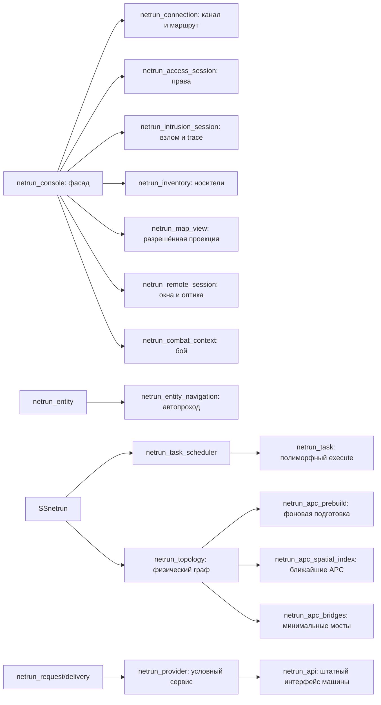

# Разработка и проверка нетрана

## Запуск игры

Нужны версии BYOND и Node.js из корневого `dependencies.sh` и штатные зависимости
сервера (включая rust-g). Используйте обычную сборку BlueMoon, а не тестовый DMB:

```powershell
# Из корня репозитория, Windows:
tools/build/build.bat
# Либо через установленный Node:
node tools/build/build.js build
```

Откройте `tgstation.dmb` в DreamDaemon и подключитесь клиентом BYOND. Штатная
сборка собирает TGUI вместе с DM. На Linux эквивалент — `tools/build/build`.
Для отдельной проверки DM без пересборки интерфейса: `node tools/build/build.js dm`.

На тестовой станции нужны работающий APC и питание устройств. Администратор
может создать `/obj/machinery/computer/netrun_terminal`, `/obj/item/netrun_deck`,
`/obj/item/netrun_shard`; для обычного получения есть исследования `netrunning`
и `netrunning_neural`. Деку откройте в руке или подключите к устройству рядом.
Локальная цепочка APC работает без NTnet; между секторами нужны настоящие
работающие `/obj/machinery/ntnet_relay` с обеих сторон.

Для атмосферных сервисов поставьте `/obj/machinery/airalarm`,
`/obj/machinery/atmospherics/components/binary/pump` или `volume_pump`.
На станции можно использовать уже существующие устройства. ID с
`ACCESS_ATMOSPHERICS` даёт обычные права управления; ключ ЛВС даёт только
обнаружение и переходы. Заблокированная сигнализация требует разблокировки на
месте либо ROOT-команды `atmos_lock`. На странице устройства показываются
условия, мешающие выполнить действие.

## Автоматические проверки

```powershell
node tools/netrun/run-tests.mjs --list
node tools/netrun/run-tests.mjs
node tools/netrun/run-tests.mjs --filter navigation
node tools/netrun/run-tests.mjs --frontend
node --test tools/netrun/run-tests.test.mjs
```

DM runner автоматически выбирает подключённые `netrun_*` тесты, собирает
изолированный профиль `hermetic`, запускает мир и проверяет свежий JSON-отчёт.
`FAIL`, `SKIPPED`, отсутствующий результат и пустая выборка являются ошибкой.
Не нужно менять `_compile_options.dm`, вписывать `TEST_FOCUS` или поддерживать
ручной список тестов. Детали, установка TGUI и `DM_EXE` описаны в
[инструкции runner](../../../../tools/netrun/README.md).

Дополнительные проверки интерфейса из `tgui/`:

```powershell
node .yarn/releases/yarn-4.18.1.cjs tsc --noEmit
node .yarn/releases/yarn-4.18.1.cjs eslint packages/tgui/interfaces/NetrunTerminal --ext .ts,.tsx
node .yarn/releases/yarn-4.18.1.cjs run tgui:build
```

Логи DM находятся в `data/logs/ci-hermetic/`, выборка — в
`tmp/netrun-tests.txt`. Тестовый мир не заменяет интерактивный прогон на рабочей
карте и измерение нагрузки с несколькими игроками.

## Объекты и ответственность



Изменяемое состояние принадлежит одному объекту. Подсистема владеет очередями
и реестрами, сеанс — правами/взломом/инвентарём, пакет — своим таймером и
контекстом отправителя, навигация — маршрутом и таймером перехода. Общие
провайдеры не хранят данные конкретной машины или оператора.

| Файл | Ответственность |
|---|---|
| `core/task_scheduler.dm` | FIFO-очереди, coalescing, приоритеты, профили, подтипы задач |
| `core/delivery.dm` | Общие таймер, допуск к MC, готовность и отмена запросов, пакетов машин и проверки нейролинка |
| `core/delivery_tasks.dm` | Единый диспетчер доставки; подклассы задают вид работы |
| `core/execution_limits.dm` | Публичные настройки подсистемы и нормализованный контракт лимитов |
| `core/interaction.dm` | Явный ввод игрока, приоритетная очередь и немедленный ответ UI |
| `core/subsystem.dm` | Постановка работы, реестры, обход активных объектов |
| `core/topology.dm` | Состав физического графа, привязки и публикация |
| `core/apc_spatial_index.dm` | Точный поиск соседей; прямой обход малых секторов |
| `core/apc_prebuild.dm` | Подготовка без публикации частичного графа |
| `core/apc_bridges.dm` | Общий для sync/background минимальный набор мостов |
| `core/routes.dm` | Деревья путей, стоимость и кеш физических маршрутов |
| `core/providers.dm`, `core/api.dm` | Контракт сервиса и адаптер штатного UI |
| `core/requests.dm` | Однократная доставка, зависимости, отмена, повторные проверки |
| `entity/navigation.dm` | Поиск разрешённого пути, отмена/замена маршрута и cooldown |
| `entity/reactions.dm` | Событийная реакция ICE и единственный отменяемый таймер боевого дедлайна |
| `integration/atmospherics.dm` | Воздушная сигнализация и два вида насосов |
| `core/incidents.dm` | Ограниченный журнал инцидентов для сетевой полиции |
| `core/fortress*.dm` | Крепость узла, модули и их боевой компонент, команды и `forge.exe`, готовые шаблоны |
| `entity/bots.dm`, `entity/bot_*.dm`, `entity/police.dm` | Моб и автономная консоль бота, мозг (задача `bot`), цели, программы, население, агенты игрока, полиция |

Расширяйте соответствующий контракт подтипом. Новому виду задачи нужен
`/datum/netrun_task` с уникальным `kind` и `execute(worker, limits)`; менять switch
подсистемы не требуется. Новому игровому сервису нужен
`/datum/netrun_provider` или `/datum/netrun_api`; полный контракт и пример — в
[PROVIDERS.md](PROVIDERS.md). Новые файлы подключаются в `tgstation.dme`, тесты —
в `code/modules/unit_tests/_unit_tests.dm`. Константы, нужные тестам, помещаются
в `code/__DEFINES/netrun.dm`, который подключён до тестовых исходников.

### Программы и демоны

`/datum/netrun_program` — общий тип исполняемых определений. Активные программы
наследуются обычными путями от `attack`, `stun`, `shield`, `repair` или реализуют
собственные методы, как `trace`. Например, `/datum/netrun_program/attack/strike`
наследует применение урона, оценку полезности для бота и сообщение о результате.
`role` обозначает категорию для интерфейса и тактики; эффект определяется
методом `apply()`, а допустимость и длительность пошагового статуса —
`can_apply_status()` и `apply_status()`. ICE использует те же объекты и их методы
проверки цели, телеграфа и доставки. Для нового эффекта не нужен центральный switch.

Демоны находятся в `/datum/netrun_program/daemon`. Их пассивные эффекты — отдельные
объекты `/datum/netrun_daemon_effect` с методом `apply()`. Инвентарь выбирает самый
сильный установленный эффект каждого вида из настоящих файлов клиента и шарда;
копии не складываются. Эффекты изменяют семантический контекст операции:
параметры взлома, трассировку, задержку маршрута или доступные возможности.
Составной демон объединяет эти эффекты без проверок его ID в игровых обработчиках.

Определения программ и эффектов разделяются через реестры. Они не хранят состояние
конкретного запуска: цели и подготовка принадлежат ICE, перезарядки и файлы —
клиенту, статусы — участнику боя, параметры пассивной операции — её контексту.

### Контракты и серверные архивы

Категории контрактов определены подтипами `/datum/netrun_contract_category` в
`integration/contract_categories.dm`. Определение задаёт порог `units_per_tc`,
подписи, допустимые источники, доступность цели и способ приёма данных. Выплата,
цель и `broker status` используют один порог; общий предел выплаты задан
`NETRUN_CONTRACT_TC_CAP`. Для категорий с уникальными значениями используйте
`distinct` и переопределите `recorded_values(account)`. Определение не хранит
состояние продавца: накопления принадлежат компоненту разума, погашение — receipt
и общему payload файла. `redeem()` проверяет данные до изменения состояния и
не должен приостанавливать исполнение; консоль сохраняет общие проверки роли,
оператора и NTnet перед приёмом данных.

Сервер выбирает строковый ID через `netrun_server_content_profile()`. Новый архив
добавляется подтипом `/datum/netrun_server_content_profile`: пулы программ,
демонов и условие продвинутой добычи находятся в определении. Пулы копируются
перед выборкой. Одноразовая отметка генерации принадлежит компоненту физического
сервера, а созданные файлы — его диску; очистка диска и замена узла не дают
повторную награду.

В TGUI метаданные форматов файлов находятся в `filePresentation.ts`, правила
переноса — в `filePermissions.ts`, действия с удалёнными файлами — в
`RemoteFileActions.tsx`. Карточка узла и каталог используют одни правила запрета
удаления, чтения и скачивания. Неизвестный формат получает нейтральное оформление;
окончательную проверку доступа по-прежнему выполняет сервер при доставке.

Сигнальные обработчики отмечают изменения и ставят работу в очередь. Они не
строят граф, не сериализуют TGUI и не выполняют тяжёлые операции машины.
Для окончательной проверки действия используйте новый request-owned path tree;
разрешения из UI и заимствованная таблица маршрутов не являются авторизацией.

`COMSIG_NETRUN_NODE_CHANGED` на самом узле обслуживает живые игровые зависимости;
на SSnetrun он сообщает о привязке, удалении и доступности для машинных сервисов.
Интерфейсы подписываются на `COMSIG_NETRUN_NODES_CHANGED`: один пакет
`address => merged_flags` на границе прохода worker. Записи журналов и удалённого
диска имеют `NETRUN_CHANGED_DETAILS`; они не запускают обработку питания,
перепривязку к APC или пересборку карты. Журналы ЛВС также объединяют уведомления
до границы прохода. Прямое чтение `ui_data()` сначала принимает накопленный пакет.

Разбор профайлера, изменения алгоритмов и ограничения описаны в
[PERFORMANCE.md](PERFORMANCE.md).

## Лимиты исполнения и отзывчивость

Значения по умолчанию объявлены как `NETRUN_DEFAULT_*` в `code/__DEFINES/netrun.dm`.
Администратор/код подсистемы меняет соответствующие поля `SSnetrun`;
`get_execution_limits(TRUE)` нормализует их перед следующим `fire()`.
Задачи получают один объект `netrun_execution_limits` и не читают произвольные
глобальные числовые константы внутри `execute`.

| Поля SSnetrun | Назначение и исходные значения |
|---|---|
| `task_adaptive_budget`, `task_budget_ms`, `task_min_budget_ms` | Адаптивный бюджет CPU, 6 / 1 мс |
| `task_pressure_tick_usage` | TICK_USAGE, при котором включается минимальный бюджет: 100 |
| `task_min_per_pass`, `task_max_per_pass` | Предел числа задач за один проход: 2 / 192 |
| `task_initial_cost_ms`, `task_cost_floor_ms`, `task_cost_smoothing` | Начальная оценка / нижняя оценка CPU и EMA: 0,1 / 0,05 мс / 0,15 |
| `task_population_interval` | Интервал обхода реестров: 1 секунда |
| `apc_prebuild_operations` | Максимум шагов фоновой подготовки APC: 96 |
| `task_priority_rotation` | Весовая последовательность CRITICAL / NORMAL / BACKGROUND |
| `task_critical_late_after`, `task_normal_late_after`, `task_background_late_after` | Пороги счётчиков опоздания: 2 / 5 / 20 секунд |
| `route_refresh_interval`, `route_expiry_interval` | Обновление / удаление таблиц маршрутов: 1 / 30 секунд |
| `ui_refresh_interval`, `ui_activity_lease`, `node_activity_duration` | Фоновое обновление UI / активный сеанс / подсветка узла: 1 / 3 / 5 секунд |
| `task_interactive_priority`, `task_interactive_burst`, `ui_interactive_flush` | Класс явного ввода, максимум подряд перед обычной задачей, немедленный ответ: CRITICAL / 8 / TRUE |

Отрицательные, бесконечные и ошибочные значения не создают бесконечный цикл.
Число задач, шаги prebuild и интервалы ограничены; `min` не превышает `max`.
Ошибочная весовая последовательность дополняется недостающими классами, чтобы
фоновая работа сохраняла возможность исполнения.

`netrun_task/continuation` обслуживает подготовку APC, прогрев маршрутов и рассылку
исследований. Подкласс выполняет конечную порцию в `advance()` и возвращает TRUE
после завершения; общая реализация объединяет повторную постановку и сохраняет
приоритет. Размер порции задаёт предметный алгоритм, общий MC ограничивает время
и число задач. Рассылка исследований отправляет не более четырёх получателей за
одну порцию.

Планировщик хранит один объект задачи на пару `kind + target`, включая время её
исполнения. Повторная постановка ожидающей задачи обновляет `last_requested_at`
и при необходимости повышает приоритет; исходный `enqueued_at` и место в FIFO
сохраняются. Сигналы во время исполнения отмечают один следующий проход, который
`finish()` ставит в очередь тем же объектом после учёта текущего выполнения.
Продолжения используют этот же механизм. Отмена снимает ожидающую работу или
отметку следующего прохода, не удаляя объект под исполняющимся стеком.
Ожидающие задачи не имеют TTL и не теряются из-за задержки очереди. Разные пакеты
команд остаются отдельными задачами; заменяемые снимки состояния объединяет
транспорт по собственному смысловому ключу.

Для просмотра нагрузки в игре откройте **Debug.1) Logs → Netrun Task Statistics**
(нужны права `R_DEBUG`). Окно обновляется по кнопке, без фонового таймера. По типам
задач доступны запросы, созданные объекты, объединения, повторные проходы, отмены,
число исполнений, суммарное/среднее/максимальное CPU-время, ожидание и превышения
бюджета. Отдельно показаны текущая очередь, выполняющиеся задачи и выборка до
32 конкретных задач с типом владельца. Сортировка по CPU выделяет дорогие типы,
по очереди и ожиданию — отстающую работу. Счётчики накопительные с создания
планировщика; чтение снимка не меняет очередь и не удерживает игровые объекты.
CPU измеряется внутри вызова `execute()`; работа асинхронного native callback
после возврата `waitfor = FALSE` в этот замер не входит. Для выполняющейся задачи
показано прошедшее реальное время, для ожидающей — возраст запроса.

`netrun_delivery` обслуживает пользовательские запросы, пакеты машин и отложенную
проверку нейролинка. Таймер только допускает готовую работу к общему MC; готовый
пакет не получает дополнительный искусственный тик перед каждой ступенью
телекоммуникаций. `cancel_delivery()` освобождает таймер и запись очереди одинаково
при ранней доставке, отмене и удалении владельца. Маршрут, права, журнал и результат
остаются ответственностью предметного пакета. Обработчик, который ожидает ввод,
может уступить исполнение, сохраняя собственное состояние и проверки отмены.

Все способы обнаружения используют один реестр APC и один `select_targets()` сервиса. Несколько физических серверов могут отвечать за одну исследовательскую БД, но одна мутация отправляется одному выбранному владельцу.

`note_ui_activity()` подтверждает активность открытого UI. `note_user_action()` означает
явное действие и сразу ставит объединяемую задачу в отдельную входную очередь.
Обе очереди подчиняются общему CPU-бюджету и максимуму задач. После ограниченной
серии ввода обслуживается одна обычная задача. `finish_user_action(node)` обновляет
состояние затронутой машины и отправляет UI без секундного ожидания; защита от
повторного входа сохраняется. Доставка пакета по-прежнему ждёт сетевую задержку
и повторно проверяет оператора, маршрут, права и cooldown.

Ответ `input_ack` повторяет только короткий текстовый `_netrun_action` после
обычной проверки допуска TGUI. Он означает обработку ввода сервером, включая
отказ по игровым условиям. Успех команды определяется её результатом и состоянием.

Открытая консоль держит лёгкие подписки независимо от выбранной страницы:
изменения выбранного устройства, закреплённых окон, маршрута, удалённого диска,
журнала ЛВС и чата помечают UI грязным. `invalidate_ui()` сразу ставит одну
объединяемую задачу в обычную очередь, не ожидая секундного `populate_tasks()`.
Фоновые события соблюдают `ui_refresh_interval`; только явный ввод обходит
интервал перерисовки. Повторные события сохраняют грязное состояние, не создавая
цикл повторной постановки задачи в том же тике.
Сигнальный обработчик не строит граф и не отправляет JSON. Очередь остаётся
под общим CPU-бюджетом; явный ввод сохраняет отдельную приоритетную очередь.
Штатный auto-update отключён и у терминала, и у программы NTOS.

Холодный узел обрабатывает обычные сигналы не чаще раза в 10 секунд после
**завершённой обработки** (`last_processed_at`). Новые сигналы объединяют флаги,
но не сдвигают уже назначенный срок: постоянный поток не откладывает последнюю
пачку навсегда. До этого срока новая node task не создаётся. Глобальный поток
`COMSIG_NETRUN_NODE_CHANGED` для карт и консолей отправляет одну пачку; локальный
сигнал самого узла и реальные игровые поля остаются актуальными.

Исключения — изменение привязки/удаление, доступность маршрута и истечение
таймера. Они не ждут холодного интервала. Выбранное устройство, источник,
закреплённое активное окно, ближайшие устройства в 7 тайлах и конкретные пути
к цели/пеленгу получают короткую lease до 3 секунд и быстрый fallback раз в
секунду. Только активный UI или игрок/тело погружения продлевает интерес;
движение автономного ICE не делает весь отдел горячим. Ping и пакеты продлевают
интерес только к своим сохранённым hops; второе дерево маршрутов не строится.
После потери интереса тихие legacy-узлы сверяются раз в 30 секунд.

Параметры подсистемы: `node_update_interval` (10 секунд), `node_poll_interval`
(1 секунда), `node_idle_poll_interval` (30 секунд). Команды и доставка пакетов
по-прежнему проверяют реальное состояние и свежий маршрут независимо от
периодичности представления.

Тяжёлая подписка проекции принадлежит только видимой карте. Скрытая карта
не копит адреса изменённых узлов. Контекстные подписки отслеживают открытых
зрителей, экипировку и цепочку контейнеров переносной консоли; смена оператора
обновляет слушатели. Закрытие окна последнего оператора не останавливает
обновления остальных зрителей. После закрытия UI и истечения activity lease
слушатели снимаются, а удаление консоли отменяет её ожидающую задачу.

Оставлена ограниченная сверка полей, которые старый код меняет прямой записью:
списка ID-доступов зрителей, переключателей NTnet и `netrun_status()` одного
видимого устройства (например, заряда APC). Сверка не сериализует тихую панель.
Обратные отсчёты, асинхронные страницы NTnet и
штатные окна с непрерывными данными по-прежнему получают периодические снимки.
Новые провайдеры должны публиковать `state_signals`, а изменения дисков — идти
через `netrun_file_store`, чтобы доставка была событийной.

При входе сущности, начале взлома и применении боевой программы просыпаются
затронутые ICE. Их задачи объединяются; спящие патрули остаются в обычной очереди.
Активный каст держит один отменяемый таймер дедлайна. Повторный wake не продвигает
`world.time`, не уменьшает cooldown и не сокращает телеграф атаки (минимум 2 секунды).
При отладке сравнивайте `WaitMax`/`Late`, `Ovr` и `Done` в статусе подсистемы;
`profile_summary()` планировщика показывает CPU и ожидание по видам работ.

## Проверка игрового сценария перед релизом

1. Откройте терминал, найдите устройство, смените сектор/этаж, сузьте фильтры и
   выберите результат поиска. Узел должен стать виден, камера — перейти к нему.
2. Начните взлом закрытой ЛВС. Перейдите в файлы и карту: предупреждение об атаке
   остаётся доступным, ввод не теряет фокус. Отмена атаки убирает предупреждение.
3. Оставьте консоль бездействовать, затем начните новый взлом: старое время
   простоя не должно сразу увеличивать trace.
4. Сущностью начните автопроход, замените цель во время cooldown, отмените
   кнопкой и совершите ручной переход. Проверьте исчезновение цели из HUD.
5. Отключите APC/реле/целевой сервис после отправки запроса. Действие должно
   отмениться при доставке; восстановление устройства не переигрывает пакет.
6. Измените насос через физический интерфейс и проверьте состояние на карте;
   затем измените уставку через сеть. Проверьте ограничения прав, проводов и
   диапазона, работу штатной атмосферы и журнал расследований.
7. На большой карте проверьте drag/zoom, связи, пересекающие экран, несколько
   одновременных окон, закрытие/повторное открытие и восстановление map snapshot.

Счётчики планировщика и topology полезны для профилирования, но не являются
гарантией задержки: бюджет проверяется между операциями. Переходы фаз prebuild
могут включать создание индекса и сортировку. Для оценки нагрузки фиксируйте
карту, количество устройств/активных сеансов и версии компилятора/TGUI.

## Межмашинный транспорт через APC

Отдельного сервера адресов в рабочей схеме нет. Обнаружение использует единый
реестр служб, привязанных к текущим узлам и APC. Изменяемое физическое состояние
и кеш деревьев APC принадлежат `netrun_topology`; реестр не хранит копию графа.

| Файл | Ответственность |
|---|---|
| `core/service_registry.dm` | Жизненный цикл служб, индексы типов/тегов, запуск после инициализации |
| `core/service_discovery.dm` | Объединение запросов, ограниченная очередь обнаружения и отмена |
| `core/routes.dm` | Общий поиск путей, физические деревья APC и таблицы UI |
| `core/machine_routes.dm` | Текущие кабели концов, кеш пар и сборка пути из общего дерева APC |
| `core/machine_transport.dm` | Значения сообщений, допуск пакета, задержка, доставка и журнал |

`send(service_id, message, recipient_tag)` принимает владение сообщением и
подтверждает только постановку в очередь. Даже точный адрес проходит через
`service_discovery` под общим бюджетом MC; обработчик машины не вызывается
из интерфейса или движения персонажа. Один источник объединяет ожидающие
запросы одинакового типа/тега; заменяемая телеметрия объединяется отдельно от
команд. После загрузки карты ожидающие запросы допускаются порциями по восемь.
Одна пачка фиксирует кандидатов один раз и проверяет до восьми за задачу,
останавливаясь также по минимальному CPU-бюджету worker. Поиск и рассылка
тратят одну порцию оставшегося бюджета прохода; дешёвая рассылка допускает
до восьми пакетов, дорогая возвращает управление после первого шага.
Смена игрового тика также завершает порцию. Даже промах индекса тегов
не запускает скрытый полный обход; маршрут и права повторно проверяются
при доставке.
При отсутствии получателя/маршрута операция завершается отказом; восстановление
связи требует нового запроса и не переигрывает ранее отказанную команду.

Обнаружение, адресная отправка и групповой поиск используют один
`select_targets()`. Исследовательская служба выбирает одного физического
владельца общей БД, поэтому несколько связанных серверов не дублируют списание
или начисление. Политика `discovery_target_limit()` останавливает поиск после
первого доступного владельца, не вычисляя отброшенные маршруты остальных.
Ноль означает полный broadcast. `resolve()` выполняет доступный только для чтения поиск по тому
же реестру и живым маршрутам. `send_to()` адресует уже известного собеседника;
для него сохраняются обычные проверки отправки и доставки.

Ограничения: 64 ожидающих типа/тега на источник, 64 сообщения в одном запросе,
4096 ожидающих сообщений и 2048 пакетов данных. Нет таймеров повторения DNS,
пакетов запроса/ответа DNS или копий каталога служб в каждой машине. Старые
пути типов/плат `netrun_server/dns` сохранены для совместимости карт как обычный
информационный сервер; они не публикуют службу адресов и не появляются отдельно
на старте. Информационный сервер с семенем размещается в телекоммуникациях.

Деревья APC содержат только транзитную инфраструктуру. Текущие кабели источника
и получателя добавляются на границе маршрута; движение одного конечного узла
не пересчитывает дерево APC. Общий кеш ограничен 512 корнями, кеш пар — 8192
путями. Ключи проверяют владельца графа, поколения инфраструктуры/доступности,
текущие APC и стоимость обоих кабелей. Кеш не заменяет живую проверку пути.

Восстановление APC без native-сигнала проверяется только для уже обнаруженных
недоступных APC, не чаще одного раза за тик. В этот индекс попадают начальные
отказы, изменения состояния и отказы, обнаруженные при построении или проверке
пути; восстановление и удаление освобождают запись. Положительные маршруты
проверяют реальные узлы перед использованием, а отрицательные деревья получают
новую ревизию после восстановления. Здоровые APC не опрашиваются общим обходом
станции при каждом тике сетевого трафика. Малый индекс реле сохраняет проверку
настроек, у которых нет общего native-сигнала.

Индекс достигнутых ЛВС хранит первый адрес, подтверждающий физический вход в
сеть. Действия проверяют живой путь к этому адресу; при его отказе проверяются
другие достигнутые входы той же ЛВС. Обнаруженный отказ сразу обновляет ревизию
графа и индекс восстановления. Отрисовка использует согласованный снимок,
который сам по себе не служит подтверждением доступа для действия.

Синхронный поиск пути навигации и проверка угрозы следующего перехода заимствуют
актуальную таблицу маршрутов и освобождают заимствование через `release_path_tree()`.
Они не копируют всю станцию и не сохраняют таблицу в таймере; для операций,
переживающих `sleep()` или `do_after()`, по-прежнему нужна собственная копия.
Охотник ICE при сборе целей проверяет жителей каждого host-узла один раз,
включая узлы без нарушителей. Порядок поиска, проверка доступа и физические
переходы остаются общими с остальными операциями.
LRU отдельно обрабатывает вставку, замену значения и обращение к существующей
записи. Новый ключ сразу связывается с концом очереди; отсутствующий ключ
не требует удаления, а текущий MRU — перестановки. Лимит и порядок вытеснения
одинаковы для положительных и отрицательных маршрутов.
Индекс `apcs_by_area` использует сектор и обслуживаемую базовую область APC,
даже если сам APC смонтирован снаружи. При наличии родного APC поиск не обходит
чужие области сектора; равные расстояния разрешаются прежним порядком адресов.
Индекс и кеш ближайшего APC обновляются общей ревизией инфраструктуры.
После подготовки APC-кандидатов `advance_bindings()` прогревает членство малыми
порциями: сначала LAN самих APC, затем остальные узлы, до 16 записей за вызов.
Геометрия опубликованных рёбер при dirty не ремонтируется. Принудительный маршрут
по-прежнему может завершить публикацию сразу и отменить подготовку; финальный
обход берёт свежий реестр, включая появившиеся между порциями устройства.
Сортируются кандидаты APC и списки соседей с двумя и более элементами. Порядок
всех конечных узлов не участвует в выборе маршрута. Ребро использует одно сравнение
адресов, существующий индекс дубликатов и одно вычисление физического расстояния.
`last_rebuild_costs` и `peak_rebuild_costs` содержат только CPU фаз публикации.
Коммуникационные обходы через штатные telecomms-реле остаются отдельной
политикой, доступной только пакетам связи с проверкой штатных частот/этажей.

Каждый пакет проверяет текущий маршрут при отправке и доставке, а адаптер —
штатные права и готовность устройства. `route()` возвращает принадлежащую
запросу копию, `reachable()` заимствует проверяемый путь без выделения копии.
Короткие локальные задержки меньше игрового тика сразу допускаются к MC без
промежуточного таймера; обработка остаётся асинхронной и ограниченной бюджетом.
Представление интерфейса, разрешения и исследовательские кеши не являются
источниками физической маршрутизации.

После барьера готовности общий `service_ready` обходит только индекс адаптеров
с `start_when_ready` порциями до 32 и вызывает предметный `network_ready()`.
Тысячи обычных служб с пустым callback в волну не попадают. Поздняя регистрация
ставит отдельный общий `service_initialize` с тем же барьером. Курсор хранится
у транспорта; continuation сохраняет единственный экземпляр на ключ задачи.
Автокластер РНД использует
отдельную задачу `research.cluster`, один кандидат и не более одного объединения
за шаг. Только mapped-серверы одинакового `research_network_id()` допускаются к
автоматическому объединению; построенные игроком серверы требуют явной привязки.
У `research_client` автоматическая привязка отделена от `wants_snapshots`:
готовность и периодическая проверка находят сервер, а полную базу запрашивает
потребитель. Производитель очков не подписывается на технологии только из-за
того, что ему требуется сервер для начисления.

Закрытый барьер загрузки паркует readiness, bootstrap и кластеризацию:
continuation завершается, а слабые ссылки и курсоры сохраняются у транспорта.
Обычный worker возобновляет их после открытия барьера. Задачи не опрашивают
неготовую сеть повторными немедленными выполнениями.

Security сохраняет обнаружение со стороны монитора и объявления издателя:
это позволяет восстановить подписку после появления службы или маршрута.
Монитор подавляет повторный subscribe по подтверждённой подписке текущего
поколения; слабый ограниченный кеш не заменяет проверку прав на издателе.
Управление подпиской передаёт последнее желаемое состояние и поколение:
устаревшее сообщение не вытесняет новый пакет и не отменяет новый toggle.
Управляющие advertise/subscribe/unsubscribe сохраняют `NETRUN_TASK_NORMAL`
при объединении: discovery и доставка обслуживаются в одном классе приоритета.
Повторный subscribe проверяет одного отправителя и существующий ключ;
очистка ограниченного набора подписчиков требуется при заполнении лимита.
Публикация события повторно проверяет действующие права каждого получателя.

Для состояния узлов `ensure_queued()` гарантирует одну ожидающую сверку без
повторной постановки при каждом population. Новая срочность повышает приоритет,
а изменение во время исполнения сохраняет один следующий проход. Обычный
`enqueue()` остаётся контрактом событий и continuation. Это не меняет сроки
native polling и не продлевает ожидание в FIFO.

Заменяемое сообщение может переопределить `can_replace(previous)`. Общий
транспорт и очередь discovery проверяют этот контракт перед заменой данных:
старое поколение подписки или ревизия исследований не уничтожает более новое
состояние, уже ожидающее доставки. Команды без coalescing key не объединяются.

У исследовательской БД отдельные ревизии общего состояния и каталога.
Изменение только баланса передаётся подписчикам компактным `state` с очками,
доходом и зарядами; рецепты и статические данные машин не пересобираются.
Изменение технологий, первая синхронизация и результаты действий/дисков
сохраняют полный `snapshot`. Каждая задача `research.publish` обслуживает
одного подписчика. `state` и `snapshot` имеют разные ключи объединения:
частичное обновление не вытесняет ещё не доставленный каталог. Неизвестная
ревизия каталога вызывает обычный запрос полного снимка; устаревшие пакеты
не откатывают кеш. Ревизия подписчика отражает отправленное состояние,
поэтому потерянные пакеты дополнительно восстанавливаются периодическим watch.

`netrun_copy_wire_value()` копирует JSON-подобные списки, сохраняя массивы вложенных
записей. Общий `deepCopyList()` превращает такие элементы в ассоциативные ключи;
это нарушало контракт `filter_types` у воздушной сигнализации.

Журнал узла хранит только заголовки и ограниченные метаданные. Захват тела один на
всю подсистему — 256 строк по 4096 символов; предварительное представление ограничено
96 значениями, 32 элементами списка и глубиной 4. Нативные datum/icon не удерживаются.
Расшифровка проверяет ROOT и наличие ID в журнале целевого узла при доставке.
Ответ команды записывается в snapshot операции; неизменённые snapshots не отправляются
повторно в каждом обновлении карты. Длинный маршрут не дублируется в панели заголовков.

Оригинал и копии сообщения освобождает транспорт. Подтип с принадлежащим ему
datum переопределяет `copy()`/`Destroy()`; `New()` допускает вызов без аргументов.
Происхождение пользователя передаётся отдельно от скопированных данных и
не заменяет штатную авторизацию. Удаление владельца отменяет его обнаружение,
таймеры и пакеты; разрыв пути не запускает прямой вызов получателя.

Журнал содержит ID пакета, общий ID операции, этапы
`SEND/FORWARD/RECEIVE/ACCEPT/REJECT/DROP`, адреса и причину отказа.
Тела сообщений и аргументы пользователя в журнал не попадают.

## Пакеты PDA и telecomms

`machine_telecomms.dm` сохраняет штатные `links`, фильтры типа, частоты и
ограничения этажей. `relay_information()` возвращает число принятых транспортом
пакетов: это выбирает штатный hub/bus fallback, но не означает доставку.
Вызвать `receive_information()` другой машины вправе только принявший пакет
сервис. Разрыв связи, выключение и удаление машины проверяются при доставке.
Настроенные `links` уже определяют физического собеседника, поэтому промежуточные
машины используют `send_to()` с обычной проверкой маршрута и прав при доставке.
Приёмник и логический адресат PDA обнаруживаются через сеть APC; промежуточные
телекоммуникационные звенья не выполняют дополнительный поиск.
Глубина relay переносится в копию сигнала, поэтому асинхронный цикл не сбрасывает
штатный предел 48 переходов.

Перед отправкой broadcaster hub запрашивает уровни своих relays и ждёт
возвратные пакеты. Этот этап заменяет прежнее синхронное изменение общего
`signal.levels`: копии сигналов не теряют межэтажное покрытие. Радио с физическим
RF-резервом ждёт завершения принятой telecomms-транзакции перед резервной
передачей, чтобы две асинхронные доставки не дублировали речь.

Каждый `netrun_machine_message/telecomms` владеет снимком сигнала и его списков.
Общий `netrun_telecomms_transmission` считает ожидающие ветви; Групповое обнаружение сначала
удерживает копии, затем освобождает оригинал. Само освобождение сообщения не
является ошибкой: отмена проходит через `failed(reason)`. Финальная доставка
дедуплицируется по реальному экземпляру messenger-программы.

PDA проходит полный путь устройство → приёмник → штатные telecomms-машины →
передатчик → устройство адресата. Передатчик не доставляет сообщение глобальным
вызовом программы. Штатный сервер продолжает перехватывать и журналировать
сообщения, а rigged-сообщения сохраняют свой маршрут и обработку. `signal.done`
для PDA выставляется после фактического получения программой. Пока ветви
ожидают обнаружение службы или сеть, интерфейс показывает ожидание; при отказе — причину.
Исходящая запись чата, подтверждение отправителя, журнал и cooldown появляются
после получения. Частичная массовая доставка сохраняет записи только у
получивших адресатов и показывает число доставок.

Адрес PDA-сервиса — REF установленной messenger-программы, а физический путь
принадлежит узлу устройства. Виртуальный PDA сущности использует
`entity.host_node` как proxy; его собственный узел не создаётся. При перемещении
сущности endpoint обновляет proxy перед проверкой маршрута. Автоматические
уведомления факса, штрафов и headhunt, а также консоль мониторинга сообщений
проходят тот же транспорт. Логического обхода сети для них нет. Физическое RF
вещание радио остаётся отдельным штатным каналом.

Установка программы на HDD и установка уже заполненного HDD вызывают
`program.on_install()` после привязки к компьютеру. Поэтому стандартный messenger
регистрирует контакт и imprint-подписки до первого открытия приложения.
Удаление программы или снятие диска вызывает `on_uninstall()` до сброса привязки:
активное/фоновое выполнение прекращается, контакт и подписки снимаются.
События файлов обновляют индекс служб APC установленной messenger-программы.

Интеграционные сценарии находятся в `code/modules/unit_tests/netrun_transport.dm`.
Они создают реальные APC и службы машин, ждут таймеров и проверяют доставку,
а не только постановку в очередь: холодный запрос, кэш и ответ, поздняя
инфраструктура, барьер загрузки, замена компонента, индекс тегов, отказы обнаружения и
кабеля, поток событий регистрации, журналы, атмосфера, камеры, исследования,
производство/мехфаб, коммуникационные консоли и полный путь PDA через telecomms.
Отдельно проверяются стандартная установка messenger, переустановка заполненного
HDD и замена активного/фонового приложения с обновлением обоих справочников.
Запуск: `node tools/netrun/run-tests.mjs --filter netrun_transport`; вся механика:
`node tools/netrun/run-tests.mjs`.
